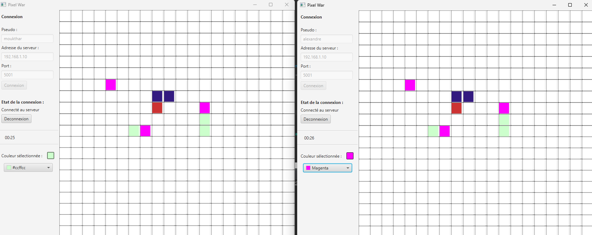

# 🎨 Pixel War - Distributed Real-Time Collaborative Grid

  
  
  

An interactive client-server collaborative "Pixel War" application developed in **Java** using **JavaFX** for the graphical user interface. The project demonstrates a strong command of network programming, concurrency management, and dual networking architectures implemented in both **TCP** and **UDP Multicast**.

---

## 🚀 Key Technical Highlights

* **Dual Network Architectures:** 
  * **TCP Implementation:** Connection-oriented server (`ServerSocket`) managing multiple clients concurrently via dedicated worker threads (`ClientHandler`) and object serialization streams.
  * **UDP Multicast Implementation:** Connectionless architecture using `MulticastSocket` for dynamic server discovery, group communication, and efficient grid state broadcasting.
* **Concurrency & Thread Safety:** Utilizes synchronized blocks (`synchronized`) and thread-safe data structures on the server side to handle simultaneous write requests from multiple users on a shared grid without data corruption.
* **Smart Embargo / Cooldown Mechanism:** Implements a time-based reservation system (`System.currentTimeMillis()`) enforcing an embargo period per pixel to regulate write conflicts, prevent spam, and manage user timeouts.
* **Modern JavaFX GUI & Asynchronous UI:** 
  * Built with responsive layouts (`BorderPane`, `GridPane`, `ColorPicker`) and FXML configuration.
  * Asynchronous background worker threads (`Thread`, `Platform.runLater`) paired with timeline animations (`Timeline`) to seamlessly update the UI and handle client-side cooldown timers without blocking the main execution thread.
* **Object Serialization:** Leverages Java Object Streams (`ObjectOutputStream` / `ObjectInputStream`) to transmit complex state objects (such as the complete `Pixel[][]` grid) seamlessly across the network.

---

## 🛠️ Tech Stack

* **Language:** Java
* **GUI Framework:** JavaFX (FXML)
* **Networking:** Java Sockets (`Socket`, `ServerSocket`, `MulticastSocket`, `DatagramPacket`)
* **Concurrency:** `ExecutorService`, Multithreading, `synchronized` mechanisms, JavaFX concurrency (`Platform.runLater`)

